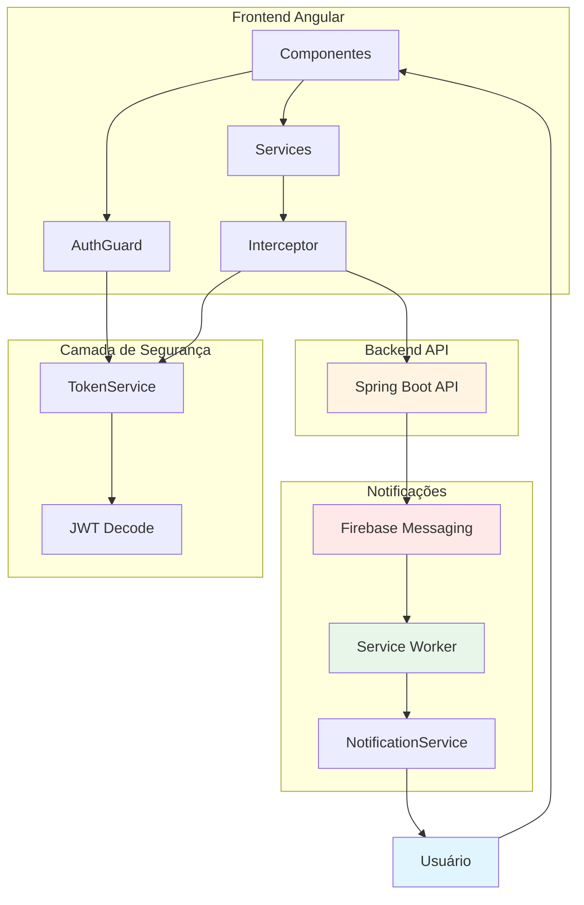
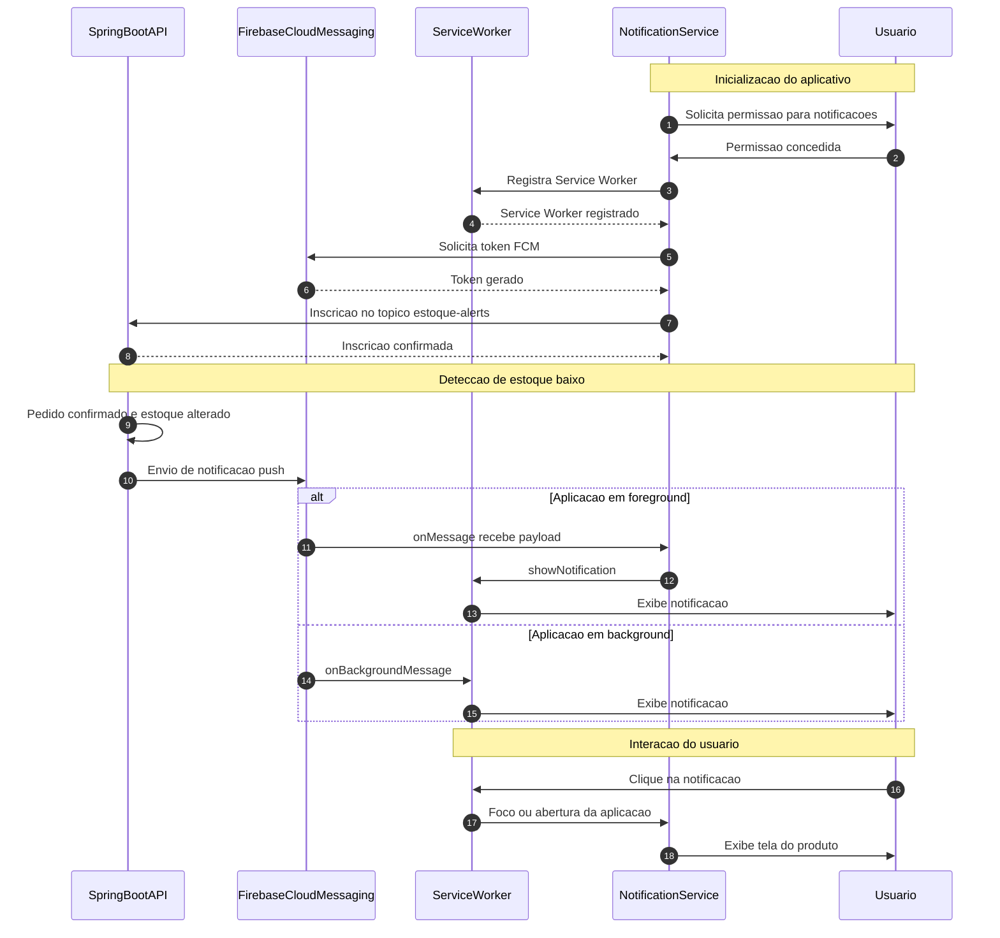
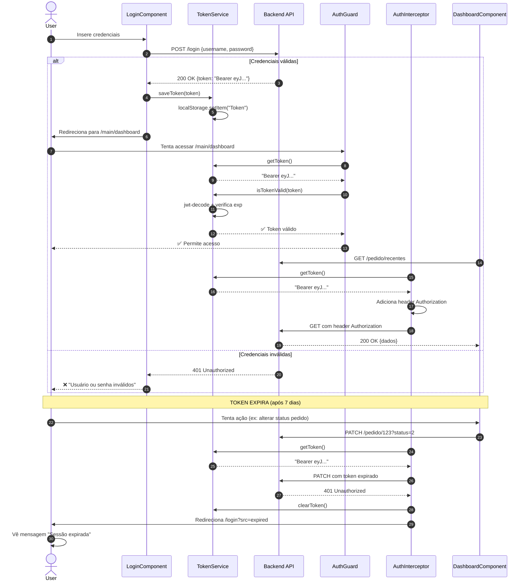

# 🎨 Painel Administrativo - E-commerce (PWA)


## 📋 Sobre o Projeto

Dashboard administrativo moderno e responsivo desenvolvido como **Progressive Web App (PWA)** para gerenciar todas as operações de uma oficina mecânica/loja de autopeças. Interface intuitiva com notificações push em tempo real, gráficos interativos e design totalmente adaptável para mobile.

### 🎯 Problema de Negócio Resolvido

Sistema completo para administradores gerenciarem:
- **Estoque em tempo real** com alertas push quando produtos ficam baixos/críticos/esgotados
- **Pedidos** com controle de status e filtros avançados
- **Dashboard analítico** com métricas de vendas e gráficos
- **Gestão de produtos**, categorias, clientes, fretes e pagamentos
- **Notificações instantâneas** via Firebase Cloud Messaging
- **Acesso mobile** completo via PWA

---

## ✨ Funcionalidades Principais

### 🔔 Sistema de Notificações Push (Firebase)
- ✅ **Alertas automáticos de estoque** em 3 níveis:
  - ⚠️ **Baixo**: Quando atinge estoque mínimo
  - 🚨 **Crítico**: Quando atinge nível crítico
  - 🔴 **Esgotado**: Quando zera o estoque
- ✅ Notificações funcionam **mesmo com app fechado** (Service Worker)
- ✅ **Actions interativas** nas notificações (Ver Produto / Fechar)
- ✅ **Deep linking** - clique na notificação abre direto no produto
- ✅ Permissão solicitada de forma amigável ao usuário
- ✅ Vibração customizada por tipo de alerta

### 📊 Dashboard Analítico
- ✅ **Gráficos interativos** com Chart.js
- ✅ Métricas de vendas por período (última semana, mês, customizado)
- ✅ Visualização de totais em tempo real
- ✅ Cards informativos com principais KPIs

### 🛒 Gestão Completa
- ✅ **Produtos**: CRUD completo com upload de imagens, categorização, controle de estoque
- ✅ **Categorias**: Organização hierárquica de produtos
- ✅ **Pedidos**: Visualização detalhada, filtros avançados, mudança de status
- ✅ **Clientes**: Cadastro e histórico de compras
- ✅ **Fretes**: Configuração de valores por região
- ✅ **Pagamentos**: Gestão de métodos de pagamento
- ✅ **Usuários**: Controle de acesso ao painel

### 🔐 Segurança e Autenticação
- ✅ **Login com JWT** (tokens válidos por 7 dias)
- ✅ **Interceptor HTTP** que adiciona token automaticamente
- ✅ **AuthGuard** protegendo rotas administrativas
- ✅ **Auto-logout** em caso de token expirado (401/403)
- ✅ Validação de token com jwt-decode
- ✅ Mensagens amigáveis para sessão expirada

### 📱 Design Responsivo Avançado
- ✅ **Tabelas responsivas customizadas** (PrimeNG DataTable)
- ✅ Em mobile, cada linha vira um **card estilizado**
- ✅ **Labels automáticas** antes de cada dado (`data-label`)
- ✅ **Menu lateral colapsável** (Sidenav)
- ✅ **Overlay mobile** para melhor UX
- ✅ Botões de ação adaptados para telas pequenas
- ✅ Paginador otimizado para mobile

### 🎨 Editor de Conteúdo Rico
- ✅ **CKEditor 5** integrado para descrições de produtos
- ✅ Formatação avançada de texto
- ✅ Suporte a imagens e links

### 🌐 PWA - Progressive Web App
- ✅ **Instalável** em qualquer dispositivo
- ✅ **Service Worker** para notificações em background
- ✅ Funciona offline (cache de assets estáticos)
- ✅ Ícones e manifest configurados
- ✅ Experiência nativa em mobile

---

## 🛠️ Tecnologias Utilizadas

### Core
- **Angular 20.3.13** - Framework frontend
- **TypeScript 5.9.3** - Linguagem principal
- **RxJS 7.8** - Programação reativa

### UI/UX
- **PrimeNG 20.3.0** - Biblioteca de componentes UI
- **PrimeIcons 7.0.0** - Ícones
- **Bootstrap 5.3.8** - Grid system e utilitários
- **Font Awesome 5.10.0** - Ícones adicionais
- **Custom CSS** - Design system próprio com gradientes e animações

### Gráficos e Dados
- **Chart.js 4.5.1** - Gráficos interativos
- **DataTables.net 2.3.4** - Tabelas avançadas (jQuery)
- **jQuery 3.7.1** - Manipulação DOM (para DataTables)

### Editor
- **CKEditor 5 (43.3.1)** - Editor WYSIWYG
- **@ckeditor/ckeditor5-angular 9.1.0** - Integração Angular

### Firebase & PWA
- **@angular/fire 20.0.1** - Integração Firebase
- **Firebase 11.10.0** - SDK completo
- **@angular/service-worker** - Service Worker para PWA

### Segurança
- **jwt-decode 4.0.0** - Decodificação de tokens JWT
- **HTTP Interceptor** - Injeção automática de tokens
- **AuthGuard** - Proteção de rotas

### Utilitários
- **Moment.js 2.30.1** - Manipulação de datas

### Build & Dev
- **Angular CLI 20.3.13** - Tooling
- **TypeScript Compiler** - Transpilação
- **Karma + Jasmine** - Testes (configurado)

---

## 🏗️ Arquitetura do Frontend

### Estrutura de Componentes

```
src/
├── app/
│   ├── componentes/
│   │   ├── login/              # Tela de autenticação
│   │   ├── main/               # Layout principal (sidenav + outlet)
│   │   ├── dashboard/          # Dashboard com gráficos
│   │   ├── produtos/           # Listagem de produtos
│   │   ├── editor-produto/     # Cadastro/edição de produtos
│   │   ├── categorias/         # Gestão de categorias
│   │   ├── pedidos/            # Listagem e filtros de pedidos
│   │   ├── clientes/           # Gestão de clientes
│   │   ├── fretes/             # Configuração de fretes
│   │   ├── pagamentos/         # Métodos de pagamento
│   │   └── usuarios/           # Gestão de usuários admin
│   │
│   ├── servicos/               # Services Angular
│   │   ├── notification.service.ts    # Firebase Cloud Messaging
│   │   ├── token-service.ts           # Gestão de JWT
│   │   ├── pedidos.servico.ts         # API de pedidos
│   │   └── ...
│   │
│   ├── guards/
│   │   └── auth.guard.ts       # Proteção de rotas
│   │
│   ├── interceptors/
│   │   └── auth.interceptor.ts # Injeção de token JWT
│   │
│   ├── model/                  # Interfaces TypeScript
│   ├── dto/                    # DTOs para comunicação com API
│   └── app.routes.ts           # Configuração de rotas
│
├── firebase-messaging-sw.js    # Service Worker (notificações background)
├── manifest.webmanifest        # PWA manifest
├── environments/               # Configurações de ambiente
└── styles.css                  # Estilos globais + responsividade

```

### Fluxo de Dados



### Sistema de Notificações Push



### Fluxo de Autenticação JWT




---

## 🔐 Segurança Implementada

### 1. **Autenticação JWT**
- Token armazenado em `localStorage`
- Validação de expiração antes de cada request
- Decodificação segura com `jwt-decode`

### 2. **Interceptor HTTP**
```typescript
// Adiciona automaticamente o token em TODAS as requisições
intercept(req: HttpRequest<any>, next: HttpHandler) {
  const token = this.tokenService.getToken();
  
  if (token && this.tokenService.isTokenValid(token)) {
    req = req.clone({
      setHeaders: { Authorization: `Bearer ${token}` }
    });
  }
  
  return next.handle(req).pipe(
    catchError(error => {
      if (error.status === 401) {
        // Token expirado → logout automático
        this.tokenService.clearToken();
        this.router.navigate(['/'], { queryParams: { src: 'expired' }});
      }
      return throwError(() => error);
    })
  );
}
```

### 3. **AuthGuard**
```typescript
canActivate(): boolean {
  const token = this.tokenService.getToken();
  
  if (token && this.tokenService.isTokenValid(token)) {
    return true; // ✅ Permite acesso
  }
  
  // ❌ Redireciona para login
  this.router.navigate(['/'], { queryParams: { src: 'unauthorized' }});
  return false;
}
```

### 4. **Proteção de Rotas**
```typescript
// Todas as rotas administrativas protegidas
{
  path: 'main',
  component: Main,
  canActivate: [AuthGuard], // 🔒 Proteção
  children: [
    { path: 'dashboard', component: Dashboard },
    { path: 'produtos', component: Produtos },
    // ... demais rotas
  ]
}
```

---

## 📱 Design Responsivo - Tabelas Customizadas

### Transformação Mobile

**Desktop (> 768px):**
```
┌─────────────────────────────────────────────┐
│ ID │ Produto     │ Estoque │ Preço │ Ações │
├─────────────────────────────────────────────┤
│ 1  │ Filtro Óleo │   45    │ 89,90 │  [📝]│
│ 2  │ Pastilha    │    3    │142,70 │  [📝]│
└─────────────────────────────────────────────┘
```

**Mobile (< 768px):**
```
┌──────────────────────────────────┐
│ 📦 Card do Produto               │
├──────────────────────────────────┤
│ ID: 1                            │
│ Produto: Filtro Óleo             │
│ Estoque: 45                      │
│ Preço: R$ 89,90                  │
│ Ações: [📝 Editar]               │
└──────────────────────────────────┘

┌──────────────────────────────────┐
│ 📦 Card do Produto               │
├──────────────────────────────────┤
│ ID: 2                            │
│ Produto: Pastilha                │
│ Estoque: 3 ⚠️                    │
│ Preço: R$ 142,70                 │
│ Ações: [📝 Editar]               │
└──────────────────────────────────┘
```

### Implementação CSS

```css
@media screen and (max-width: 768px) {
  /* Oculta cabeçalho original */
  .p-datatable .p-datatable-thead > tr > th {
    display: none;
  }

  /* Transforma linhas em cards */
  .p-datatable .p-datatable-tbody > tr {
    display: block;
    margin-bottom: 1rem;
    border-radius: 8px;
    padding: 1rem;
    box-shadow: 0 2px 4px rgba(0,0,0,0.1);
  }

  /* Células viram linhas com labels */
  .p-datatable .p-datatable-tbody > tr > td:before {
    content: attr(data-label); /* 🔥 Pega do HTML */
    font-weight: 600;
    margin-right: 1rem;
  }
}
```

---

## 🚀 Como Executar

### Pré-requisitos

- **Node.js 18+** (recomendado 20 LTS)
- **npm 9+** ou **yarn**
- **Angular CLI 20+**
- Conta **Firebase** (para notificações push)
- **Backend API** rodando (veja README do backend)

### 1. Clone o Repositório

```bash
git clone https://github.com/seu-usuario/oficina-mecanica-frontend.git
cd oficina-mecanica-frontend
```

### 2. Instale as Dependências

```bash
npm install
```

### 3. Configure o Firebase

1. Crie um projeto no [Firebase Console](https://console.firebase.google.com/)
2. Ative **Cloud Messaging (FCM)**
3. Gere uma **Web Push certificate** (VAPID key)
4. Baixe o `serviceAccountKey.json` (já configurado no backend)

### 4. Configure os Ambientes

**`src/environments/environment.ts` (desenvolvimento):**

```typescript
export const environment = {
  production: false,
  apiURL: 'http://localhost:8080', // URL do backend
  
  firebase: {
    apiKey: "SUA_API_KEY",
    authDomain: "seu-projeto.firebaseapp.com",
    projectId: "seu-projeto-id",
    storageBucket: "seu-projeto.appspot.com",
    messagingSenderId: "123456789",
    appId: "1:123456789:web:abc123",
    measurementId: "G-XXXXXXXXX"
  },
  
  vapidKey: "SUA_VAPID_KEY_AQUI" // Chave pública do Firebase (Web Push)
};
```

**`src/environments/environment.prod.ts` (produção):**

```typescript
export const environment = {
  production: true,
  apiURL: 'https://api.projetoreal.dev.br',
  
  firebase: { /* mesmas configs */ },
  vapidKey: "SUA_VAPID_KEY"
};
```

### 5. Execute em Desenvolvimento

```bash
npm start
# ou
ng serve
```

Acesse: `http://localhost:4200/admin/`

### 6. Build para Produção

```bash
npm run build
# ou
ng build --configuration production
```

Os arquivos gerados estarão em `dist/pecasbr_admin/browser/`

---

## 🧪 Testando as Funcionalidades

### 1. **Login**

**Credenciais padrão** (configure no backend):
- **Usuário:** `admin`
- **Senha:** `senha123`

### 2. **Testar Notificações Push**

1. Faça login no painel
2. **Aceite as permissões** de notificação quando solicitado
3. Abra o console do navegador (F12)
4. Veja os logs: `✅ Token FCM obtido com sucesso!`
5. No backend, crie um pedido que **zere o estoque** de um produto
6. Você receberá uma **notificação push** mesmo com o navegador minimizado

**Para testar notificação manualmente:**
- Console: `Notification.requestPermission()`
- Após permitir: `new Notification('Teste', {body: 'Funcionou!'})`

### 3. **Testar Responsividade**

1. Abra DevTools (F12)
2. Ative o **Device Toolbar** (Ctrl+Shift+M)
3. Teste em diferentes resoluções:
   - **Mobile**: 375px (iPhone)
   - **Tablet**: 768px (iPad)
   - **Desktop**: 1920px

Observe:
- ✅ Menu lateral vira **overlay** em mobile
- ✅ Tabelas viram **cards estilizados**
- ✅ Botões se reorganizam
- ✅ Paginador se adapta

### 4. **Testar Service Worker**

```bash
# Build de produção (Service Worker só funciona em prod)
ng build --configuration production

# Sirva os arquivos com um servidor HTTP
npx http-server dist/pecasbr_admin/browser -p 8080
```

Acesse `http://localhost:8080/admin/` e:
1. Aceite notificações
2. **Feche completamente o navegador**
3. No backend, zere o estoque de um produto
4. Você receberá notificação **mesmo com app fechado**

---

## 📊 Estrutura de Rotas

```typescript
/                              → Login
/main                          → Layout principal (AuthGuard)
  ├─ /dashboard                → Dashboard com gráficos
  ├─ /categorias               → Listagem de categorias
  ├─ /editor-categoria/:id     → Criar/Editar categoria
  ├─ /produtos                 → Listagem de produtos
  ├─ /editor-produto/:id       → Criar/Editar produto
  ├─ /pedidos                  → Listagem de pedidos
  ├─ /clientes                 → Gestão de clientes
  ├─ /fretes                   → Configuração de fretes
  ├─ /editor-frete/:id         → Editar frete
  ├─ /financeiro               → Relatórios financeiros
  ├─ /pagamentos               → Métodos de pagamento
  ├─ /editor-pagamentos/:id    → Editar método de pagamento
  └─ /usuarios                 → Gestão de usuários admin
```

Todas as rotas dentro de `/main` são **protegidas** pelo `AuthGuard`.

---

## 🎨 Customização de Estilos

### Paleta de Cores Principal

```css
:root {
  --primary-dark: #1E3A5F;      /* Azul escuro (fundo principal) */
  --primary-light: #233A5F;     /* Azul médio */
  --accent: #00ADB5;            /* Ciano (destaque) */
  --accent-hover: #02C2C8;      /* Ciano claro (hover) */
  --text-light: #EEEEEE;        /* Texto claro */
  --background-dark: #0F0F0F;   /* Fundo escuro */
}
```

### Botão Primary (Customizado)

```css
.btn-primary {
  background: linear-gradient(145deg, #1E3A5F, #233A5F);
  color: #EEEEEE;
  border: 2px solid #00ADB5;
  border-radius: 8px;
  box-shadow: 0 4px 10px rgba(0,0,0,0.3);
  transition: all 0.3s ease;
}

.btn-primary:hover {
  background: linear-gradient(145deg, #00ADB5, #02C2C8);
  color: #0F0F0F;
  transform: scale(1.03);
}
```

### Modificar Tema PrimeNG

Edite `src/app/app.config.ts`:

```typescript
providePrimeNG({
  theme: {
    preset: Lara, // Ou: Aura, Nora, Material
    options: {
      darkModeSelector: '.dark-mode', // Suporte a tema escuro
      cssLayer: {
        name: 'primeng',
        order: 'tailwind-base, primeng, tailwind-utilities'
      }
    }
  }
})
```

---

## 🔧 Configurações Importantes

### Base Href e Deploy URL

O app está configurado para rodar em **subdiretório** `/admin/`:

**`angular.json`:**
```json
{
  "baseHref": "/admin/",
  "deployUrl": "/admin/"
}
```

Se quiser rodar na raiz, altere para:
```json
{
  "baseHref": "/",
  "deployUrl": "/"
}
```

E ajuste `index.html`:
```html
<base href="/">
```

### Service Worker (Firebase Messaging)

**Localização:** `src/firebase-messaging-sw.js`

**⚠️ IMPORTANTE:** Este arquivo deve estar na **raiz de `src/`** e será copiado para a raiz do build.

**`angular.json` - Assets:**
```json
"assets": [
  "src/favicon.ico",
  "src/manifest.webmanifest",
  "src/firebase-messaging-sw.js", // 🔥 Crítico
  { "glob": "**/*", "input": "src/assets", "output": "assets" }
]
```

### Budgets (Limite de Tamanho)

Configurado para **4MB** máximo:

```json
"budgets": [
  {
    "type": "initial",
    "maximumWarning": "3.5MB",
    "maximumError": "4MB"
  }
]
```

Se exceder, otimize:
- Use `lazy loading` para componentes
- Reduza dependências não utilizadas
- Ative `tree-shaking`

---

## 🌐 Deploy

### Deploy em Servidor (Nginx/Apache)

1. **Build de produção:**
```bash
ng build --configuration production
```

2. **Copie arquivos para o servidor:**
```bash
scp -r dist/pecasbr_admin/browser/* usuario@servidor:/var/www/projetoreal.dev.br/admin/
```

3. **Configure Nginx:**

```nginx
server {
    listen 443 ssl;
    server_name projetoreal.dev.br;

    # Certificado SSL
    ssl_certificate /etc/letsencrypt/live/projetoreal.dev.br/fullchain.pem;
    ssl_certificate_key /etc/letsencrypt/live/projetoreal.dev.br/privkey.pem;

    # Frontend Admin
    location /admin {
        alias /var/www/projetoreal.dev.br/admin;
        try_files $uri $uri/ /admin/index.html;
        
        # CORS para Service Worker
        add_header Service-Worker-Allowed /admin/;
    }

    # API Backend
    location /api {
        proxy_pass http://localhost:8080;
        proxy_set_header Host $host;
        proxy_set_header X-Real-IP $remote_addr;
    }
}
```

4. **Reinicie Nginx:**
```bash
sudo systemctl restart nginx
```

### Deploy em Firebase Hosting

```bash
# Instale Firebase CLI
npm install -g firebase-tools

# Login
firebase login

# Inicialize
firebase init hosting

# Deploy
firebase deploy --only hosting
```

**`firebase.json`:**
```json
{
  "hosting": {
    "public": "dist/pecasbr_admin/browser",
    "rewrites": [
      {
        "source": "**",
        "destination": "/index.html"
      }
    ]
  }
}
```

---

## 🐛 Troubleshooting

### Problema: Notificações não aparecem

**Solução:**
1. Verifique permissões: `Notification.permission` deve ser `"granted"`
2. Abra DevTools → Application → Service Workers
3. Confirme que `firebase-messaging-sw.js` está registrado
4. Veja o console para erros de token FCM
5. Confirme que a VAPID key está correta em `environment.ts`

### Problema: Token JWT expira muito rápido

**Causa:** Backend configurado para tokens de curta duração.

**Solução:**
- No backend, aumente `EXPIRATION` em `JWTTokenUtil.java`
- Atualmente: 7 dias
- Se quiser 30 dias: `30 * 24 * 60 * 60 * 1000`

### Problema: CORS bloqueando requisições

**Solução no Backend:**
```java
// MyWebApplicationSecurityConfig.java
configuration.setAllowedOrigins(Arrays.asList(
    "http://localhost:4200",        // ✅ Desenvolvimento
    "https://projetoreal.dev.br"    // ✅ Produção
));
```

### Problema: Service Worker não atualiza

**Solução:**
```bash
# DevTools → Application → Service Workers → "Unregister"
# Ou force update no código:
```

```typescript
// src/main.ts
if ('serviceWorker' in navigator) {
  navigator.serviceWorker.getRegistrations().then(registrations => {
    registrations.forEach(reg => reg.unregister());
  });
}
```

### Problema: Imagens de produtos não carregam

**Causa:** Caminho incorreto ou CORS.

**Solução:**
1. Verifique se a URL da imagem está correta
2. Backend deve servir imagens com CORS habilitado
3. Exemplo de URL: `https://projetoreal.dev.br/assets/img/produto.jpg`

### Problema: Tabelas não ficam responsivas

**Solução:**
Adicione `data-label` no HTML:

```html
<td data-label="Nome do Produto">
  {{ produto.nome }}
</td>
```

O CSS pegará via `attr(data-label)` e criará labels automáticas.

---

## 📈 Melhorias Futuras

Possíveis evoluções do frontend:

- [ ] **Testes E2E** com Cypress
- [ ] **Testes unitários** com Jasmine/Karma
- [ ] **Modo escuro** (dark mode) completo
- [ ] **Internacionalização** (i18n) - PT/EN/ES
- [ ] **Lazy loading** de módulos para melhor performance
- [ ] **Cache offline** completo (PWA avançado)
- [ ] **Upload drag-and-drop** de imagens
- [ ] **Prévia de impressão** de pedidos (PDF)
- [ ] **Gráficos mais avançados** (D3.js ou Recharts)
- [ ] **WebSockets** para atualizações em tempo real
- [ ] **Auditoria de ações** do usuário
- [ ] **Filtros salvos** (favoritos)
- [ ] **Exportação** de relatórios (Excel/CSV)
- [ ] **Tema customizável** pelo usuário
- [ ] **Atalhos de teclado** para ações comuns

---

## 🔒 Segurança - Boas Práticas

### ⚠️ NUNCA Versione

Adicione ao `.gitignore`:

```
# Environments
src/environments/environment.ts
src/environments/environment.prod.ts

# Firebase
firebase-messaging-sw.js
.firebase/
.firebaserc

# Node
node_modules/
npm-debug.log
yarn-error.log

# Build
dist/
.angular/
```

### ✅ Use Arquivo de Exemplo

Crie `src/environments/environment.example.ts`:

```typescript
export const environment = {
  production: false,
  apiURL: 'http://localhost:8080',
  
  firebase: {
    apiKey: "SUA_API_KEY",
    authDomain: "seu-projeto.firebaseapp.com",
    projectId: "seu-projeto-id",
    storageBucket: "seu-projeto.appspot.com",
    messagingSenderId: "123456789",
    appId: "1:123456789:web:abc123"
  },
  
  vapidKey: "SUA_VAPID_KEY_PUBLICA"
};
```

### 🔐 Recomendações

- ✅ Use **HTTPS** em produção (obrigatório para PWA)
- ✅ Configure **Content Security Policy (CSP)**
- ✅ Ative **CORS** apenas para domínios confiáveis
- ✅ Valide **todas as entradas** do usuário
- ✅ Nunca exponha **chaves privadas** do Firebase
- ✅ Use **variáveis de ambiente** no CI/CD
- ✅ Implemente **rate limiting** no backend
- ✅ Monitore **logs de erro** (Sentry, LogRocket)

---

## 📚 Documentação Adicional

### Links Úteis

- [Angular Docs](https://angular.dev)
- [PrimeNG Components](https://primeng.org)
- [Firebase Cloud Messaging](https://firebase.google.com/docs/cloud-messaging)
- [Chart.js Docs](https://www.chartjs.org/docs/latest/)
- [CKEditor 5](https://ckeditor.com/docs/ckeditor5/latest/)
- [Bootstrap 5](https://getbootstrap.com/docs/5.3/)
- [PWA Guide](https://web.dev/progressive-web-apps/)

### Service Worker Debugging

**Chrome DevTools:**
- `Application → Service Workers`
- `Application → Notifications`
- `Console → Preserve log` (para ver logs após reload)

**Firefox DevTools:**
- `about:debugging#/runtime/this-firefox`
- `Storage → Service Workers`

**Testar notificações:**
```javascript
// Console do navegador
Notification.requestPermission().then(permission => {
  if (permission === 'granted') {
    new Notification('Teste', {
      body: 'Notificação funcionando!',
      icon: '/admin/favicon.ico'
    });
  }
});
```

---

## 👨‍💻 Autor

**Gabriel Núñez**

Desenvolvedor Full Stack | Angular & Spring Boot Specialist

[](https://www.linkedin.com/in/gabriel-nunez-contasti/)
[](https://github.com/gajonuco)
[](mailto:gajonuco@gmail.com)

---

## 🔗 Projeto Relacionado

Este frontend consome a API desenvolvida em Spring Boot:

📦 **[Backend API - Sistema E-commerce](https://github.com/gajonuco/pecasbr-api)**

---

<div align="center">

**⭐ Se este projeto foi útil, considere dar uma estrela!**

**🚀 Desenvolvido com Angular 20, PrimeNG e muito ☕**

Made with ❤️ by Gabriel Núñez

</div>
